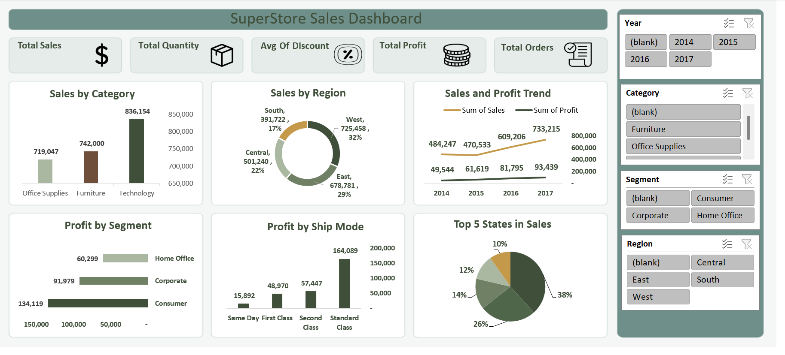

# 📊 SuperStore Sales Dashboard

**An Interactive Sales Analytics Dashboard Built with Microsoft Excel**

An interactive sales dashboard developed using Excel, Power Query, Power Pivot, and the Data Model to analyze sales performance, profitability, customer segments, and shipping methods from 2014 to 2017.

## 🖼️ Dashboard Preview

## 📌 Project Overview

The SuperStore Sales Dashboard transforms sales data into an interactive analytical report that helps users understand business performance and identify important sales and profitability patterns.

Built using Excel's Data Model and a Star Schema approach, the dashboard combines key performance indicators (KPIs) and visualizations in one place to support data-driven decision-making.

## 🎯 Business Objectives

* Monitor overall sales, quantity, profit, and discount performance.
* Analyze sales across product categories and geographic regions.
* Track sales and profit trends from 2014 to 2017.
* Compare profitability across customer segments and shipping methods.
* Identify the top-performing states by sales.
* Enable interactive exploration of sales performance.

## 📈 Key Performance Indicators (KPIs)

The dashboard tracks the following metrics:

| KPI              | Business Purpose                    |
| ---------------- | ----------------------------------- |
| Total Sales      | Measure overall sales performance   |
| Total Quantity   | Monitor the volume of products sold |
| Average Discount | Understand discount levels          |
| Total Profit     | Evaluate business profitability     |
| Total Orders     | Monitor order volume                |

## 📊 Dashboard Visualizations

### 1. Sales by Category

Compares sales performance across product categories to identify the categories contributing most to revenue.

### 2. Sales by Region

Analyzes sales distribution across geographic regions to highlight regional performance differences.

### 3. Sales and Profit Trend (2014–2017)

Tracks sales and profit over time to help identify changes in business performance.

### 4. Profit by Segment

Compares profitability across customer segments to support customer and sales strategy decisions.

### 5. Profit by Ship Mode

Examines profit across shipping methods to understand their relationship with business profitability.

### 6. Top 5 States by Sales

Highlights the five leading states by sales, helping identify important geographic markets.

## 🎛️ Interactive Features

The dashboard includes interactive slicers for:

* **Year:** Filter results by year.
* **Category:** Explore individual product categories.
* **Segment:** Compare customer segments.
* **Region:** Analyze specific geographic regions.

These filters allow users to explore the data from different perspectives without manually changing the underlying dataset.

## 🛠️ Tools & Technologies

* **Microsoft Excel:** Dashboard development and reporting.
* **Power Query:** Data preparation and transformation.
* **Power Pivot:** Data modeling and analytical calculations.
* **Excel Data Model:** Centralized data management.
* **Star Schema:** Structured relationships between data tables.
* **PivotTables & PivotCharts:** Interactive analysis and visualization.
* **Slicers:** Dynamic filtering and exploration.

## 💡 Business Questions Answered

This dashboard helps explore questions such as:

* Which product categories generate the highest sales?
* Which regions contribute most to overall sales?
* How do sales and profit change between 2014 and 2017?
* Which customer segments generate the most profit?
* How does profitability differ across shipping methods?
* Which five states lead in sales?

## 💼 Business Value

The dashboard provides a consolidated view of sales performance and profitability, helping stakeholders explore trends, compare business segments, and identify areas that may require further investigation.

Its interactive design makes it easier to examine performance across different years, categories, customer segments, and regions.

## 🚀 Potential Future Improvements

* Add monthly and quarterly sales comparisons.
* Analyze profit margins by category and region.
* Investigate the impact of discounts on profitability.
* Include year-over-year growth metrics.
* Develop a geographic sales performance analysis.

## 👤 Author

**Bebo Magdy**

Aspiring Data Analyst | Business Intelligence | Data Visualization

---

*This project demonstrates practical applications of Excel-based data modeling, interactive reporting, and business analytics.*
